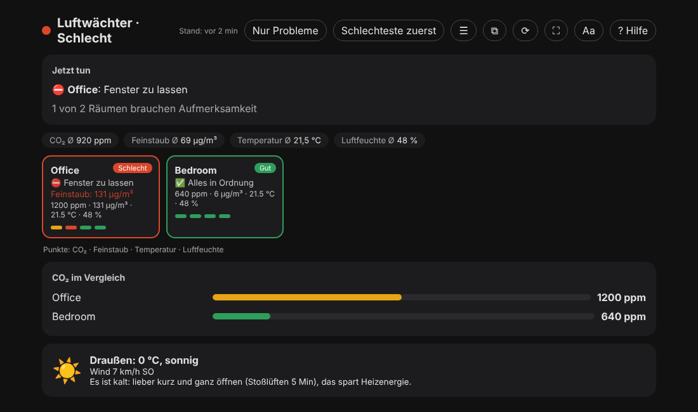

# Luftwächter für Home Assistant

 

Luftqualität pro Raum, Lüftungshinweise und Fensterempfehlungen für Home Assistant, mit einem Seitenleisten-Panel für den ganzen Haushalt. Ergänzung zum [Luftwächter-Widget für Windows](https://github.com/DanStasiak/airguard-widget). Deutsch und Englisch, keine Cloud, keine zusätzlichen Zugänge.  
🇬🇧 [English version](README.md)

## Neu in 0.23.0

- **Die Karte hat einen grafischen Editor** und neue Optionen: `compact: true` (eine schmale Zeile), `symbols: true` (Formen ✓ ! ✕ zusätzlich zu den Farben), `accent: true` (farbiger Rand), `face_style: emoji` (Emoji statt Maskottchen), `rooms: [Büro, Schlafzimmer]` (Haus-Übersicht nur für diese Räume), `title` und `tap_action: panel` (Antippen öffnet das Panel beim Raum). Sie wird von Screenreadern vorgelesen und lässt sich mit der Tastatur bedienen. Alle Optionen: siehe die englische [README](README.md#lovelace-card).
- **Neue Aktion `luftwaechter.test_reminder`** löst eine Beispiel-Fenstererinnerung aus, damit du Handy und Lautsprecher prüfen kannst, ohne ein Fenster zu öffnen (Entwicklerwerkzeuge → Aktionen).
- **Blueprint Fenster-Erinnerung:** *Nur sprechen, solange jemand zu Hause ist* (Person, Gruppe oder Binärsensor) und *Antippen der Meldung öffnet das Luftwächter-Panel* (standardmäßig aus).
- **Systeminformationen** zeigen Version, Raumanzahl und ob das letzte Update geklappt hat (Einstellungen → System → Reparaturen → ⋮ → Systeminformationen). Die Einstellungen haben für jedes Feld eine Beschreibung, und gleiche Start- und Endstunde der Erinnerungen wird abgelehnt.
- Der Browser-Tab zeigt das Gesicht des Hauses (🙂 😐 😷), und eine Übersicht aller Blueprints mit Import-Knopf steht in [docs/BLUEPRINTS.md](docs/BLUEPRINTS.md).

## Lovelace-Karte und weitere Blueprints (neu in 0.21.0)

Die Karte `type: custom:luftwaechter-card` (optional `room: Büro`) zeigt Gesicht, Satz und Werte eines Raums oder eine Haus-Übersicht; sie wird automatisch hinzugefügt. Neue Blueprints: *Heizung pausieren, solange ein Fenster offen ist* (freiwillig, mit Wiederherstellung) und *Lüftungs-Timer „Fenster jetzt schließen“*.

## Fenster-Erinnerungen (neu in 0.20.0)

Bleibt ein Fenster zu lange offen (erste Wartezeit 10 min, draußen unter 10 °C, aktiv 8 bis 22 Uhr), löst Luftwächter das Ereignis `luftwaechter_reminder` aus und wiederholt es alle 5 Minuten. Es bleibt beim Ratgeber: Der Blueprint *Fenster zu lange offen* schickt eine Handy-Meldung mit den Tasten *Schlummern* und *Bis zum Schließen überspringen* und kann auf Lautsprechern sprechen. Aktionen: `luftwaechter.snooze`, `luftwaechter.skip_until_closed`, `luftwaechter.clear_snooze`. Optionen unter Konfigurieren: Außentemperatur-Sensor, Wartezeiten, aktive Stunden, Fenster ignorieren, Erinnerungen stumm schalten. Sensoren: `binary_sensor.luftwachter_window_reminder` und je Bereich `..._window_reminder`.

## Wo man Erinnerungen, Lautsprecher, Ton und Regensensor einstellt

Zwei Stellen: Luftwächter entscheidet nur, *wann*; Home Assistant entscheidet, *wie* es zugestellt wird.

**1. Wann und was zählt: Einstellungen → Geräte & Dienste → Luftwächter → Konfigurieren.**
- *Regensensor*: ein Binärsensor, der bei Regen an ist. Leer gelassen sucht Luftwächter einen, dessen Name auf „rain“ oder „Regen“ endet.
- *Außentemperatur-Sensor*: ein echter Außensensor; leer wird die Wetter-Entität genommen.
- *Erinnern nach (erste Wartezeit)*, *Wiederholen alle*, *Nur erinnern unter*, *Aktiv ab / bis (Stunde)*, *Erinnerungen stumm, solange an*, *Für diese Fenster nie erinnern*: die Regeln der Fenster-Erinnerungen.

**2. Wohin es geht (Handy und Lautsprecher): die Automation aus dem Blueprint.** Blueprint *Luftwächter - window open too long (phone and speakers)* importieren (Ordner blueprints), dann **Einstellungen → Automatisierungen & Szenen → Automatisierung erstellen → Blueprint verwenden**. Die Eingaben:
- *Phone notify service*: zum Beispiel `notify.mobile_app_mein_handy`. Leer = keine Push-Nachricht.
- *Text to speech engine* und *Speakers*: **hier wählst du den Lautsprecher.** TTS-Engine (zum Beispiel Piper) und einen oder mehrere `media_player` wählen. Ist eines von beiden leer, wird nichts gesprochen.
- *Spoken text*: standardmäßig `{{ message }}`; außerdem `{{ room }}`, `{{ window }}` und `{{ minutes }}`.
- *Snooze length*: was der Knopf **Snooze** auf dem Handy bewirkt.

**Ton an oder aus.** Wähle im Blueprint bei *Voice on/off switch (optional)* einen Hilfsschalter (`input_boolean` oder `switch`, neu in 0.22.0). Gesprochen wird nur, solange dieser Schalter an ist; die Handy-Push-Nachricht bleibt unberührt. Du schaltest ihn per Dashboard, Taster oder App. Ohne Schalter ist die Stimme immer an. Weitere Wege:
- *Ton aus, Handy-Push an:* das Feld *Speakers* (oder die TTS-Engine) leeren und speichern.
- *Ton an:* Engine und Lautsprecher wieder wählen.
- *Alles zeitweise aus:* die Automation ausschalten oder unter Konfigurieren *Erinnerungen stumm, solange an* mit einem eigenen Hilfsschalter nutzen. Ein Hilfsschalter ist der schnellste Weg, alle Erinnerungen ohne Bearbeiten zu pausieren.

Aus demselben Blueprint kannst du mehrere Automationen machen, zum Beispiel eine nur fürs Handy und eine, die nur in der Küche spricht.

### Regensensor
Mit Regensensor (Konfigurieren → *Regensensor* oder ein Binärsensor namens „... rain“/„... Regen“) richtet sich der Rat nach dem echten Wetter am Haus statt nur nach der Vorhersage:
- Ein offenes Fenster bei Regen bekommt den Rat „Fenster schließen“ (und `binary_sensor.luftwachter_<raum>_close_window` geht an).
- Ein Raum mit verbrauchter Luft, der sonst lüften soll, wird angewiesen, **zu warten, bis der Regen aufhört**, außer sein CO₂ liegt schon über der Grenze *mittel*; dann zählt die Luft mehr als der Regen.
- Erinnerungen und Schließen-Rat nutzen dieselben Regen- und Außentemperatur-Werte, damit Handy, Lautsprecher, Panel, Lovelace-Karte und Windows-Widget übereinstimmen.

## Schnellstart
1. **Luftwächter** im Marketplace installieren, Home Assistant neu starten.
2. Einstellungen → Geräte & Dienste → Integration hinzufügen → **Luftwächter**.
3. CO₂-, Feinstaub-, Temperatur- oder Feuchte-Sensoren einem **Bereich** zuweisen. Der Raum erscheint innerhalb einer Minute im Panel.

Hilfe: [SUPPORT.md](SUPPORT.md).

## Das kann es
- **„Jetzt tun“-Übersicht**: welche Räume Aufmerksamkeit brauchen, der schlechteste zuerst, mit Verlaufslinie der letzten Stunde.
- **Raumansicht**: Status, „Das fällt auf“ mit Grenzwerten, Skalen, Verlauf über 6 Stunden, 24 Stunden oder 7 Tage, Taupunkt und Schimmelwarnung.
- **Lüftungshinweis**: Fenster öffnen, schließen oder offen lassen, wie lange, bei Sturm warten, Regenhinweis aus deiner Wettervorhersage.
- **Lüftungs-Timer** mit Signalton und „Fenster jetzt schließen“.
- **Geräte pro Raum**: Lichter, Heizung, Rollos mit Live-Status.
- **Für gemeinsame Bildschirme**: Textgröße, Vollbild, Durchschalt-Modus, Raumsuche, Listenansicht, angeheftete Lieblingsräume, Farbenblind-Modus.
- **Für deine Automationen**: ein Sensor pro Raum, ein Haus-Sensor, ein „Aufmerksamkeit“-Binärsensor, das Ereignis `luftwaechter_level_changed` und ein Blueprint.
- **Jeder in seiner Sprache**: das Panel folgt der Sprache im Profil des jeweiligen Benutzers.

## Installation (Marketplace)
Home Assistant 2026.11 und neuer hat den **Marketplace** eingebaut (Einstellungen → Marketplace); er hat HACS abgelöst. Auf älteren Versionen suchst du in HACS nach *Luftwächter*.
1. **Einstellungen → Marketplace** öffnen, nach **Luftwächter** suchen und öffnen. Beim ersten Mal bestätigst du den Risikohinweis.
   *Ausweichweg (zum Beispiel direkt nach einer neuen Version oder bei älteren Versionen):* **Einstellungen → Marketplace → Über Link hinzufügen** (HACS: ⋮ → **Benutzerdefinierte Repositories**, Typ *Integration*) und `https://github.com/DanStasiak/luftwaechter-ha` einfügen. Eigene Projekte brauchen eine GitHub-Verbindung (Home Assistant zeigt einen Code, den du auf GitHub eingibst, ein Passwort wird nicht weitergegeben).
2. **Luftwächter** im Marketplace öffnen, **Herunterladen**, Home Assistant neu starten.
3. Einstellungen → Geräte & Dienste → **Integration hinzufügen** → *Luftwächter*. Optional eine Wetter-Entität wählen.
4. In der Seitenleiste **Luftwächter** öffnen. Sichtbar für alle Benutzer im Haushalt.

**Manuell:** `luftwaechter.zip` von der [aktuellen Version](https://github.com/DanStasiak/luftwaechter-ha/releases/latest) laden, nach `config/custom_components/luftwaechter/` entpacken, Home Assistant neu starten.

Voraussetzung: Home Assistant 2025.10 oder neuer.

## So kommen Räume ins Panel
Weise CO₂-, Feinstaub-, Temperatur- oder Feuchte-Sensoren einem **Bereich** zu (Einstellungen → Bereiche). Der Raum erscheint von selbst, sobald ein Sensor Werte meldet. Ein Fenstersensor mit der Geräteklasse „window“ liefert zusätzlich „Fenster öffnen / schließen“. Findet Luftwächter länger als etwa 5 Minuten keinen Raum, zeigt Home Assistant unter **Einstellungen → Reparaturen** einen Hinweis.

## Einstellungen
**Einstellungen → Geräte & Dienste → Luftwächter → Konfigurieren**: Wetter-Entität, Bereiche ausblenden, Grenzwerte für CO₂ und Feinstaub (Standard 1000 / 1500 ppm und 20 / 50 µg/m³) und nach wie vielen Minuten ohne Daten das Panel warnt (Standard 10).

## Entitäten
| Entität | Zustand | Attribute |
|---|---|---|
| `sensor.luftwachter_<raum>` | good / fair / poor | action, headline, detail, window, trend, since, mold, dew, values, devices |
| `sensor.luftwachter_house` | schlechtester Wert | rooms, outside, limits, attention, attention_rooms, worst_room |
| `sensor.luftwachter_worst_room` | Name des Raums mit der schlechtesten Luft | level, attention |
| `sensor.luftwachter_good_rooms` | Anteil der Räume mit guter Luft, % | good, total |
| `sensor.luftwachter_average_co2` | durchschnittlicher CO₂-Wert aller Räume, ppm | |
| `sensor.luftwachter_average_temperature` | durchschnittliche Temperatur aller Räume, °C | |
| `sensor.luftwachter_average_humidity` | durchschnittliche Luftfeuchte aller Räume, % | |
| `binary_sensor.luftwachter_mold_risk` | an, solange in einem Raum die Luftfeuchte 70 % oder mehr beträgt | count, rooms |
| `sensor.luftwachter_rooms_to_ventilate` | Anzahl der Räume, für die „Fenster öffnen“ geraten wird | rooms |
| `binary_sensor.luftwachter_sensor_problem` | an, solange der Luftsensor eines Raums nichts meldet oder als veraltet ignoriert wird (Diagnose) | count, rooms |
| `binary_sensor.luftwachter_<raum>_ventilate` | an, solange für den Raum „Fenster öffnen“ geraten wird | room, headline, level |
| `binary_sensor.luftwachter_<raum>_close_window` | an, solange „Fenster schließen“ geraten wird (Luft wieder gut und draußen kalt oder Regen) | room, headline, detail, open_minutes |
| `binary_sensor.luftwachter_attention` | an, solange ein Raum schlecht ist oder Lüften/Warten rät | count, rooms, worst_room |

Die Entity-IDs hängen von deiner Installation ab. Ereignis und Blueprint sind in der [englischen Beschreibung](README.md#events-for-automations) erklärt; der Blueprint lässt sich mit einem Klick importieren:

Dritter Blueprint „Sag Bescheid, wenn ein Sensor verstummt“: den Binärsensor *Sensor-Problem* wählen und wie lange das Problem bestehen muss (standardmäßig 30 Minuten); in Texten gehen `{{ rooms }}` und `{{ count }}`. Mehr Beispiele zum Kopieren: [`docs/AUTOMATION-EXAMPLES.md`](docs/AUTOMATION-EXAMPLES.md).

Zweiter Blueprint „Ans Lüften erinnern“: Lüften-Sensor eines Raums wählen, dazu wie lange der Rat bestehen muss (z. B. 5 Minuten), dann festlegen, was passiert:

## Wandtablet
**Kiosk-Modus** (Taste `K` oder Menü → „Kiosk-Modus“): größte Schrift, Räume wechseln automatisch, Knöpfe blenden aus. Direkt starten: `https://<dein-ha>/luftwaechter#kiosk`. Im Menü außerdem: Browser-Hinweise (wenn ein Raum schlecht wird), Sprache wählen, Ansicht zurücksetzen.

## Tastatur
← → Raum wechseln · `1`–`9` Raum wählen · `Pos1` / `Ende` erster / letzter Raum · `E` Verlauf als CSV · `A` Browser-Hinweise · `B` Farbenblind-Modus · `G` Maskottchen oder Emoji · `+` / `−` Textgröße · `T` Zeitraum des Verlaufs · `L` Sprache · Esc zurück · `/` suchen · `S` sortieren (schlechtester, Name, CO₂) · `P` Raum anheften · `O` nur Probleme · `V` Listenansicht · `C` Hausübersicht kopieren · `K` Kiosk-Modus · `M` Menü · `R` durchschalten · `F` Vollbild · `H` oder `?` Hilfe. Am Handy wischt du im Raum nach links oder rechts, um den Raum zu wechseln.

## Fehlersuche
- **Panel zeigt noch alte Texte nach dem Update**: Browser-Seite hart neu laden (Strg + F5).
- **Kein Raum sichtbar**: Sensoren einem Bereich zuweisen, siehe oben; Reparaturen prüfen.
- **Fehler melden**: [Issue öffnen](https://github.com/DanStasiak/luftwaechter-ha/issues/new/choose); die Diagnosedaten der Integration helfen dabei.

## Häufige Fragen
- **„Sensor meldet nichts mehr“:** Der Luftsensor eines Raums hat länger nichts gemeldet (oft leere Batterie oder WLAN-Lücke). Die Leiste nennt die Räume; der Binärsensor *Sensor-Problem* meldet dasselbe für Automationen.
- **Schimmelgefahr:** Ab 70 % Luftfeuchte in einem Raum (die Grenze lässt sich unter „Konfigurieren“ ändern). Der Binärsensor *Mold risk* und die Leiste im Panel nennen die Räume.
- **Tägliche Zusammenfassung:** Blueprint *Tägliche Luft-Zusammenfassung* importieren oder Beispiel 6 aus [docs/AUTOMATION-EXAMPLES.md](docs/AUTOMATION-EXAMPLES.md) kopieren.
- **Sprachausgabe:** Der Blueprint *Sprechen, wenn ein Raum schlecht wird* liest den Hinweis über deine Sprachausgabe (z. B. Piper) auf den gewählten Lautsprechern vor.
- **Neu in welcher Version:** [docs/UPGRADING.md](docs/UPGRADING.md).
- **Dashboards:** Fertige Karten stehen in [docs/DASHBOARD.md](docs/DASHBOARD.md).

## Kompatibilität
Benötigt Home Assistant 2025.10 oder neuer, jede Installationsart. Das Panel läuft in aktuellem Chrome, Edge, Firefox und Safari, am PC und am Handy. Es wird nichts außerhalb von Home Assistant kontaktiert.

## Deinstallation
1. Einstellungen → Geräte & Dienste → Luftwächter → ⋮ → **Löschen**.
2. In HACS Luftwächter öffnen → ⋮ → **Entfernen**, danach Home Assistant neu starten.
3. Automationen aus den Blueprints behalten ihre eigene Kopie; lösche sie, wenn du sie nicht mehr brauchst.

## Datenschutz
Alles läuft in deinem Home Assistant. Keine Konten, keine Cloud-Dienste, keine Telemetrie.

MIT © 2026 Dan Stasiak
