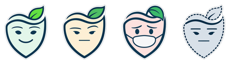
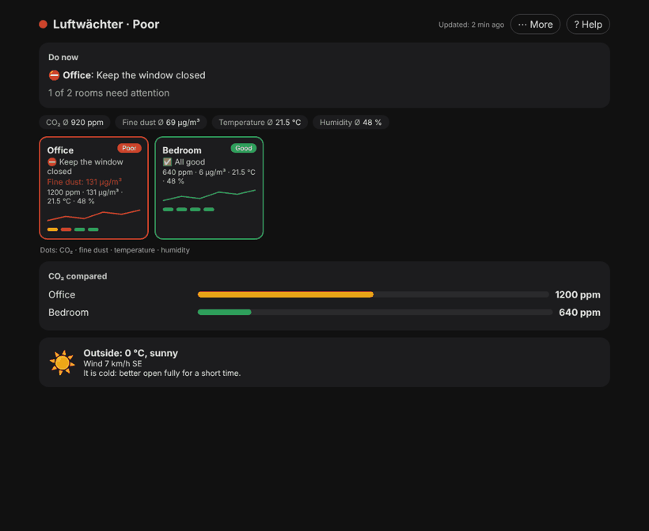
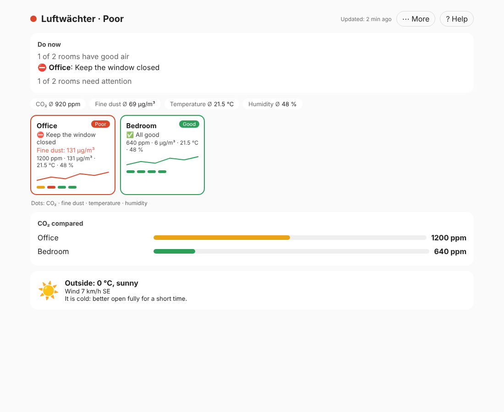
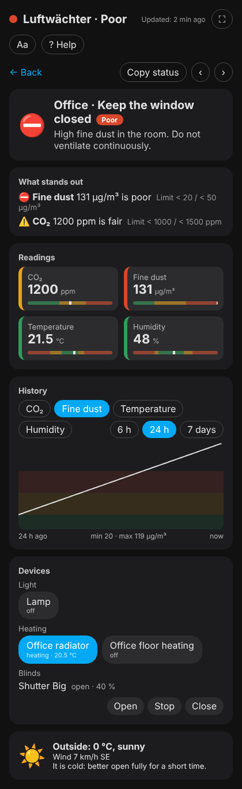
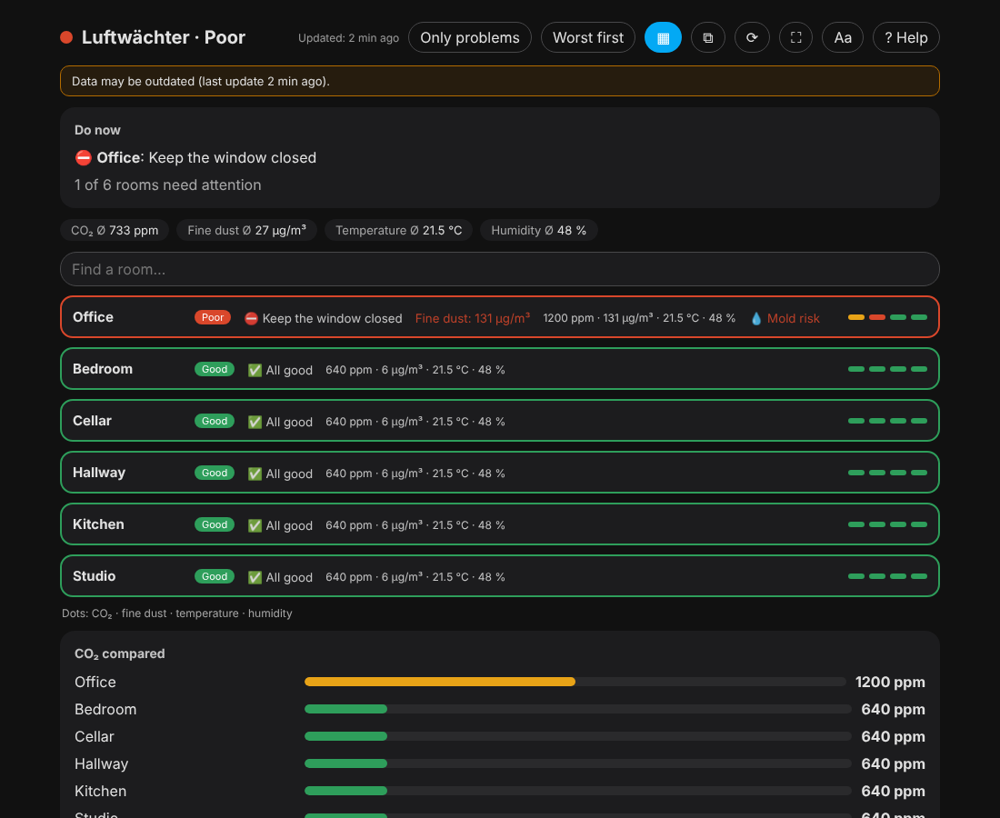
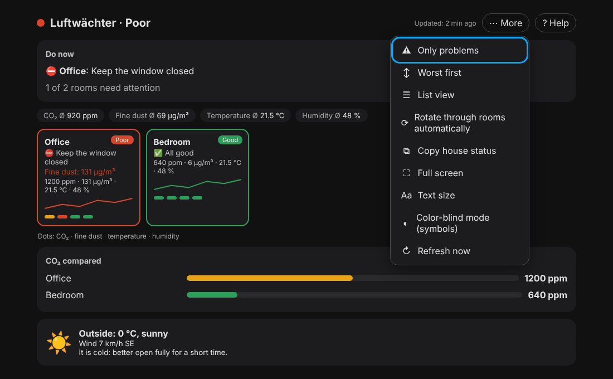
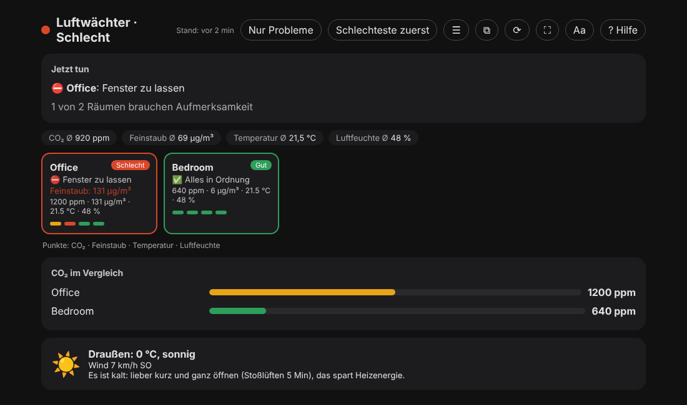
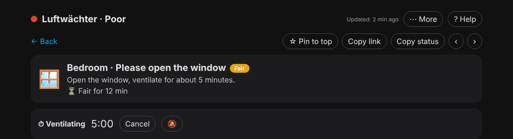
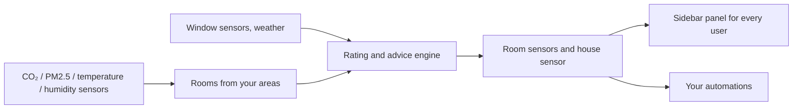
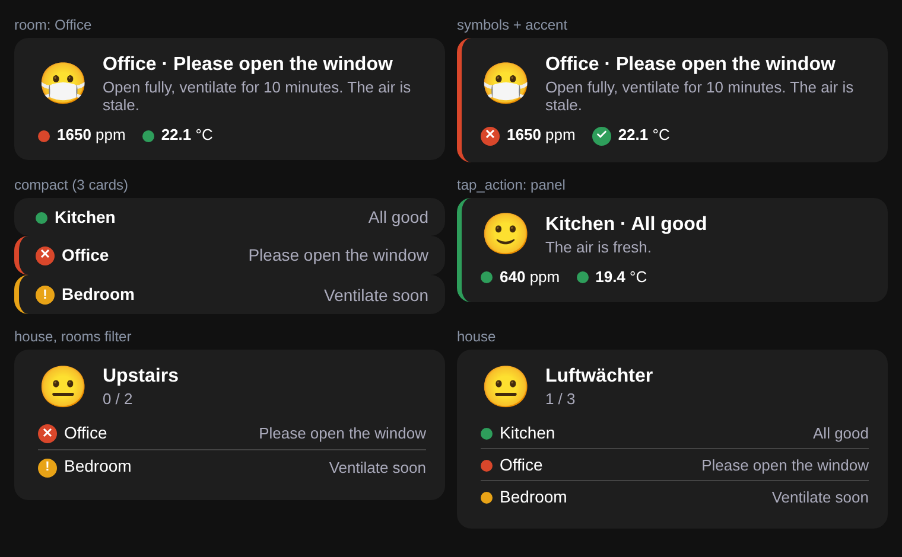

<p align="center"></p>
<p align="center"></p>

# Luftwächter for Home Assistant

[](https://github.com/DanStasiak/luftwaechter-ha/actions/workflows/validate.yml)
[](https://github.com/DanStasiak/luftwaechter-ha/releases)


[](LICENSE)
[](https://github.com/DanStasiak/luftwaechter-ha/releases)
[](https://github.com/DanStasiak/luftwaechter-ha/commits/main)
[](https://github.com/DanStasiak/luftwaechter-ha/stargazers)
[](https://github.com/DanStasiak/luftwaechter-ha/issues) [](https://buymeacoffee.com/dstasiak)

🇩🇪 [Deutsche Version](README.de.md)

Room air quality, ventilation advice and window hints for Home Assistant, with a sidebar panel for the whole household.
Companion to the [Luftwächter Windows widget](https://github.com/DanStasiak/airguard-widget). German and English, no cloud, no extra requests.

[](https://my.home-assistant.io/redirect/hacs_repository/?owner=DanStasiak&repository=luftwaechter-ha&category=integration)

<p align="center"></p>

**Contents:** [Quick start](#quick-start) · [Features](#features) · [Install](#install-marketplace) · [Update](#update) · [How it works](#how-it-works) · [Limits](#limits) · [Entities](#entities) · [Settings](#settings) · [Events](#events-for-automations) · [Blueprint](#blueprint) · [All blueprints](docs/BLUEPRINTS.md) · [Card](#lovelace-card) · [Examples](docs/AUTOMATION-EXAMPLES.md) · [Dashboards](docs/DASHBOARD.md) · [Upgrading](docs/UPGRADING.md) · [Architecture](docs/ARCHITECTURE.md) · [Windows widget](#windows-widget) · [Wall tablet tips](#wall-tablet-tips) · [FAQ](#faq) · [Roadmap](#roadmap) · [Troubleshooting](#troubleshooting) · [Privacy](#privacy)

## Quick start
1. Install **Luftwächter** from the Marketplace and restart Home Assistant (see [Install](#install-marketplace)).
2. Settings → Devices & services → Add integration → **Luftwächter**.
3. Give your CO₂, fine-dust, temperature or humidity sensors an **area**. The room shows up in the sidebar panel by itself, within a minute.

Questions? See [SUPPORT.md](SUPPORT.md).

## Features
- **Browser alerts (opt-in):** More → *Browser alerts* shows a notification when a room turns poor while the tab is in the background.
- **Your own language and a reset:** More → *Language* overrides the profile language for this browser; *Reset view settings* clears pins, sort, size and the rest.
- **Screen-reader friendly:** level changes are announced politely, tiles have tooltips with the full advice, everything works by keyboard.
- **Do-now overview**: which rooms need attention, worst first, with a coloured dot per reading on every tile.
- **Room view**: status badge, "what stands out" with the limits, gauge bars, 24 h / 6 h / 7 day history charts with hover readout.
- **Advice**: open, close or keep the window (a window left open after the air is good again is flagged once it is cold or raining; an optional rain sensor, picked in the options or found by its name, makes it wait for the rain to stop); how long to ventilate; wait for storms; rain-soon hint from your weather forecast.
- **Help built in**: what each reading means, typical causes of bad values, what helps.
- **Devices per room**: lights, heating, blinds (open / stop / close) with live state.
- **Made for shared screens**: text size switch for wall tablets, remembers your last room, arrow keys, stale-data warning.
- **Readings at a glance**: every tile lists all four readings, and a CO₂ ranking compares the rooms.
- **Better charts**: axis labels, a marker for the latest value, and a CSV download of the shown history.
- **Light and dark**: follows your Home Assistant theme.
- **Hide areas** you do not want in the panel (garage, cellar).
- **Your limits**: adjust the CO₂ and fine dust limits in the integration options.
- **Trends and events**: rising/falling arrows, and an event whenever a room changes level, for your own automations.
- **Keyboard shortcuts** for wall tablets and desktops.
- **Ventilation timer**: start a countdown for the recommended time and get a clear "close the window now" alert, even after switching rooms.
- **House at a glance**: average CO₂, fine dust, temperature and humidity, a level label on every tile, and "copy house status" to share it.
- **Your language, per person**: each user sees the panel in their own profile language (English or German).
- **Easy to start**: a built-in guide when no rooms are found yet, deep links (`#room=<name>`) and a full-screen button.
- **Mold warning**: at 70 % humidity or more (you can change the limit under Configure) a room gets a tip, and the room view shows the dew point.
- **Search and list view**: find a room by name (press `/`) and switch the overview to a compact list (press `V`).
- **Tidy header, clear menu**: everything secondary sits in a labelled **More** menu (press `M`).
- **Sparklines and time in level**: the last hour on every tile, and "Poor for 1 h 35 min" in the room view.
- **Color-blind mode** with symbols next to the colours, and **Refresh now** from the panel.
- **Automation blueprint**: one click to get a "room became poor" notification, no YAML needed.
- **Pin favourite rooms** (key `P`) and sort by highest CO₂.
- **Repairs hint** in Home Assistant when no room is found, with what to do.
- **German README** ([README.de.md](README.de.md)).
- **Timer sound** (optional) and a **copy link** button for the deep link to a room.
- **Mold-risk bar, average CO₂ sensor and mold-risk binary sensor**, icons on every entity, two more blueprints (mold, daily summary).
- **More keys:** `E` saves the room history as CSV, `+` / `−` change the text size.
- **Quiet-sensor warning bar** in the panel, a *rooms to ventilate* counter and a third blueprint for sensor problems.
- **Entities for automations**: one sensor per room, a house sensor and an "Attention" binary sensor.

| Light theme | Phone |
|---|---|
|  |  |

| List view |
|---|
|  |

| More menu |
|---|
|  |

| German | Ventilation timer |
|---|---|
|  |  |

| Room | Help |
|---|---|
|  |  |

## Install (Marketplace)
Home Assistant 2026.11 and newer have the **Marketplace** built in (Settings → Marketplace). It replaced HACS. On older versions use HACS and search for *Luftwächter* there.
1. Open **Settings → Marketplace**, search for **Luftwächter** and open it. On the first visit you accept the Marketplace risk notice.
   *Fallback (for example right after a release, or on older versions):* open **Settings → Marketplace → Add from link** (HACS: ⋮ → **Custom repositories**, type *Integration*) and paste `https://github.com/DanStasiak/luftwaechter-ha`, or click the button above. Custom projects also need a GitHub connection (Home Assistant shows a code to enter on GitHub, no password is shared).
2. Open **Luftwächter** in the Marketplace, click **Download**, then restart Home Assistant.
3. Settings → Devices & services → **Add integration** → *Luftwächter*. Pick a weather entity (optional, used for outside hints).
4. Open **Luftwächter** in the sidebar. It is visible to every household user.

Requires Home Assistant 2025.10 or newer.

**Manual install:** download `luftwaechter.zip` from the [latest release](https://github.com/DanStasiak/luftwaechter-ha/releases/latest), unzip it into `config/custom_components/luftwaechter/` and restart Home Assistant.

## Update
1. **Settings → Marketplace → Installed → Luftwächter → Update** (or the update entity under Settings → Updates).
2. **Restart Home Assistant.** The integration's Python code is only loaded at startup, so a restart is needed for new logic.
3. Hard-refresh the browser (Ctrl+Shift+R) or reopen the app, so the panel loads the new JavaScript.

## Settings
**Settings → Devices & services → Luftwächter → Configure**: choose the weather entity, the areas to hide, the CO₂ and fine dust limits (defaults 1000 / 1500 ppm and 20 / 50 µg/m³) and the humidity from which a room counts as mold risk (default 70 %) and after how many minutes without data the panel warns (default 10). Temperature and humidity use fixed comfort ranges. The panel, gauges and advice follow your limits.

## How it works

The integration recalculates every minute (or on demand with the `luftwaechter.refresh` action). The engine is plain Python without Home Assistant imports and is covered by tests.

## How rooms are found
Put your CO₂ and/or fine dust (PM2.5) sensors into an **area**. Temperature, humidity and window sensors in the same area are used too.
Optional: give entities the label `airguard` to choose exactly which sensors and devices are used. Without the label the panel shows lights, heating and blinds of the area.

## Limits
| Reading | Good | Fair | Poor |
|---|---|---|---|
| CO₂ | < 1000 ppm | < 1500 ppm | above |
| Fine dust (PM2.5) | < 20 µg/m³ | < 50 µg/m³ | above |
| Temperature | 17–23 °C | 13–25 °C | outside |
| Humidity | 30–60 % | 25–70 % | outside |

The room level is the worst of the four.

## Entities
| Entity | State | Attributes |
|---|---|---|
| `sensor.luftwachter_<room>` | good / fair / poor | action, headline, detail, window, trend, since, mold, dew, values, devices, sources |
| `sensor.luftwachter_house` | worst level | rooms, outside, limits, updated, attention, attention_rooms, worst_room, silent_rooms, ventilate, ventilate_rooms, co2_avg, temp_avg, rh_avg, mold_rh, mold, mold_rooms |
| `sensor.luftwachter_worst_room` | name of the room with the worst air | level, attention |
| `sensor.luftwachter_good_rooms` | share of rooms with good air, % | good, total |
| `binary_sensor.luftwachter_<room>_ventilate` | on while the advice for the room is "open the window" | room, headline, level |
| `binary_sensor.luftwachter_<room>_close_window` | on while the advice is "close the window" (air fine again and cold or raining outside) | room, headline, detail, open_minutes |
| `sensor.luftwachter_average_co2` | average CO₂ of all rooms, ppm | |
| `sensor.luftwachter_average_temperature` | average temperature of all rooms, °C | |
| `sensor.luftwachter_average_humidity` | average humidity of all rooms, % | |
| `binary_sensor.luftwachter_mold_risk` | on while a room's humidity is at or above your mold limit (default 70 %) | count, rooms |
| `sensor.luftwachter_rooms_to_ventilate` | number of rooms that advise opening a window | rooms |
| `binary_sensor.luftwachter_sensor_problem` | on while a room's air sensor is silent or ignored as stale (diagnostic) | count, rooms |
| `binary_sensor.luftwachter_attention` | on while a room is poor or advises opening / waiting | count, rooms, worst_room |

Example automation: notify when a room gets poor.
```yaml
triggers:
  - trigger: state
    entity_id: sensor.luftwachter_house
    to: poor
actions:
  - action: notify.notify
    data: { message: "Air quality is poor, open a window." }
```
(Entity IDs depend on your installation; check the entity list.)

### Events for automations
Whenever a room changes level, Luftwächter fires `luftwaechter_level_changed` with `room`, `room_key`, `from`, `to` and `headline`.
```yaml
triggers:
  - trigger: event
    event_type: luftwaechter_level_changed
    event_data: { to: poor }
actions:
  - action: notify.notify
    data: { message: "{{ trigger.event.data.room }}: {{ trigger.event.data.headline }}" }
```
The room attribute `trend` is `up`, `down` or `flat` (CO₂ or fine dust compared with about 15 minutes ago), and `since` is how many minutes the room has been at its current level.

### Blueprint
Prefer clicks to YAML? Import the blueprint and pick the level, an optional room and what should happen (notification, speech, a light, anything). In your actions you can use `{{ room }}`, `{{ headline }}`, `{{ level }}` and `{{ previous }}`.

[](https://my.home-assistant.io/redirect/blueprint_import/?blueprint_url=https%3A%2F%2Fgithub.com%2FDanStasiak%2Fluftwaechter-ha%2Fblob%2Fmain%2Fblueprints%2Fautomation%2Fluftwaechter%2Flevel_changed.yaml)

**Speak it out loud:** the *speak when a room turns poor* blueprint reads the hint with your text-to-speech (for example Piper) on the speakers you pick.

**Four more blueprints:** *warn me about mold risk* (humidity stays high) and *daily air summary* (a message at a time you choose). Both are in the blueprints folder and import like the others.

**Third blueprint, "tell me when a sensor goes quiet":** pick the *Sensor problem* binary sensor and how long it must last (30 minutes by default); use `{{ rooms }}` and `{{ count }}` in your texts. More ideas, ready to paste: [`docs/AUTOMATION-EXAMPLES.md`](docs/AUTOMATION-EXAMPLES.md).

**Second blueprint, "remind me to ventilate":** pick a room's *ventilate* sensor and how long the advice must last (for example 5 minutes), then choose what happens. Use `{{ room }}` and `{{ headline }}` in your texts.

[](https://my.home-assistant.io/redirect/blueprint_import/?blueprint_url=https%3A%2F%2Fgithub.com%2FDanStasiak%2Fluftwaechter-ha%2Fblob%2Fmain%2Fblueprints%2Fautomation%2Fluftwaechter%2Fventilate_reminder.yaml)

## Window reminders

Luftwächter can remind you when a window stays open too long, and it stays advice-only: it fires an event and exposes sensors; *you* choose what happens (the *window open too long* blueprint sends a phone push with **Snooze** and **Skip until closed** buttons and can speak on your speakers).

- **When it fires:** the window has been open for the first wait (default 10 min), it is colder than your limit outside (default below 10 °C), and it is inside your active hours (default 08 to 22). It repeats every 5 minutes (default) until the window closes.
- **Outside temperature:** pick a real outdoor sensor under Configure (*Outside temperature sensor*); without one the weather entity is used. The same value feeds the "close the window" advice.
- **Snooze, skip, ignore, mute:** the actions `luftwaechter.snooze` (window, minutes), `luftwaechter.skip_until_closed` and `luftwaechter.clear_snooze` handle one window; *Never remind for these windows* ignores windows for good; *Mute reminders while on* pauses all reminders while a switch or binary sensor is on (for example a window you air while a device charges). Snoozes survive a Home Assistant restart.
- **Entities:** `binary_sensor.luftwachter_window_reminder` (any window due) and `binary_sensor.luftwachter_<area>_window_reminder` (its attributes list every open window and why a reminder is held back, for example `snoozed`, `early`, `warm`, `hours`).
- **Event:** `luftwaechter_reminder` with `room`, `window`, `entity_id`, `minutes_open`, `outside_temp` and `message`.
- Window contacts are found by device class *window* or *opening*, or a *door* contact whose name says window or Fenster.

## Where to set up reminders, speaker, sound and rain sensor

Two places, because Luftwächter only decides *when* and Home Assistant decides *how*:

**1. When and what counts: Settings → Devices & services → Luftwächter → Configure.**
- *Rain sensor*: pick a binary sensor that is on while it rains. Left empty, Luftwächter looks for one whose name ends in "rain" or "Regen".
- *Outside temperature sensor*: a real outdoor sensor; left empty, the weather entity is used.
- *Remind after*, *Repeat every*, *Remind only below*, *Active from / until*, *Mute reminders while on*, *Never remind for these windows*: the reminder rules described above.

**2. Where it is delivered (phone and speaker): the automation made from the blueprint.** Import the blueprint *Luftwächter - window open too long (phone and speakers)* (blueprints folder), then **Settings → Automations & scenes → Create automation → Use blueprint**. Its inputs:
- *Phone notify service*: for example `notify.mobile_app_my_phone`. Empty = no push.
- *Text to speech engine* and *Speakers*: **this is where you choose the speaker.** Pick your TTS engine (for example Piper) and one or more `media_player` speakers. If either is empty, nothing is spoken.
- *Spoken text*: `{{ message }}` by default; you can also use `{{ room }}`, `{{ window }}` and `{{ minutes }}`.
- *Snooze length*: what the **Snooze** button on the phone does.
- *Speak only while someone is home (optional)* (new in 0.23.0): pick a person, a group or a binary sensor; the voice is spoken only while it is `home` or `on`, so an empty house stays quiet. The phone push is not affected.
- *Tapping the push opens the Luftwächter panel* (new in 0.23.0, off by default): a tap on the phone notification opens the panel at the room of the window.

**Sound on or off.** Pick a helper in the blueprint input *Voice on/off switch (optional)* (an `input_boolean` or `switch`, new in 0.22.0). The voice is spoken only while that switch is on; the phone push is not affected. Flip it from a dashboard, a button or the app. Without a switch the voice is always on. Other ways:
- *Sound off, phone push on:* empty the *Speakers* input (or the TTS engine) and save.
- *Sound on:* pick the engine and the speakers again.
- *Everything off for a while:* turn the automation off (its switch on the Automations page), or use *Mute reminders while on* under Configure with a helper switch of your own. A helper switch that you flip is the quickest way to pause all reminders without editing anything.

You can create several automations from the same blueprint, for example one that only pushes to the phone and one that only speaks in the kitchen.

### Rain sensor
With a rain sensor (Configure → *Rain sensor*, or a binary sensor named "... rain"/"... Regen"), the advice follows the real weather at your house instead of the forecast alone:
- A window that is open while it rains gets the advice "close the window" (and `binary_sensor.luftwachter_<room>_close_window` turns on).
- A room with stale air that would normally be told to ventilate is told to **wait until the rain stops**, unless its CO₂ is already above the *fair* limit; then the air matters more than the rain.
- Reminders and the close-window advice use the same rain and outside-temperature values, so the phone, the speaker, the panel, the Lovelace card and the Windows widget agree.

## Lovelace card

The integration adds a small card to your dashboards automatically (no resource to add). Add it from the card picker (*Luftwächter*); it has a visual editor, so no YAML is needed. In YAML:

```yaml
type: custom:luftwaechter-card
room: Office        # room name or key; leave out for the whole-house summary
```

It shows the face, the one-sentence advice and the readings, and follows your Home Assistant language (German or English).

<p align="center"></p>

| Option | Default | What it does |
| --- | --- | --- |
| `room` | whole house | Room name or key. Leave out for the house summary. |
| `rooms` | all | House summary only: a list of the rooms to show, for example `[Office, Bedroom]`. |
| `title` | Luftwächter | Title of the house summary. |
| `values` | `true` | `false` hides the readings of a room. |
| `compact` | `false` | One slim line instead of the big card, handy for a row of rooms. |
| `symbols` | `false` | Shapes (✓ ! ✕) next to the colours, so the level is readable without colours. |
| `accent` | `false` | A coloured edge on the left that follows the air level. |
| `tap_action` | nothing | `panel`: a tap opens the Luftwächter panel at that room. |
| `face_style` | `mascot` | `emoji`: use emoji faces instead of the Luftwächter mascot. |

The card announces itself to screen readers ("Office: good air") and can be used with the keyboard when `tap_action` is on.

## More blueprints

Every blueprint with all its inputs is listed in [docs/BLUEPRINTS.md](docs/BLUEPRINTS.md), with an import button for each.


- **Pause heating while a window is open (opt-in):** switches the thermostats you pick off after the window was open for a while and restores their previous mode and temperature from a snapshot once all picked windows are closed. Luftwächter itself never switches heating.
- **Airing timer, "close the window now":** when a window opens, waits until it is closed, until the room's *close window* sensor turns on, or until your airing time is over, then says or sends "close the window now" if it is still open.

## Actions and diagnostics
- `luftwaechter.refresh` recalculates all rooms immediately.
- `luftwaechter.test_reminder` (new in 0.23.0) fires one sample window reminder (optional `room` and `message`), so you can check your phone and speaker automation without opening a window. In Developer tools → Actions, pick *Send a test reminder*.
- `luftwaechter.snooze`, `luftwaechter.skip_until_closed` and `luftwaechter.clear_snooze` control window reminders (see above).
- **System information** (Settings → System → Repairs → ⋮ → System information) shows the Luftwächter version, the number of rooms and whether the last update worked.
- **Download diagnostics** (device page, three dots) gives a compact, anonymous report for bug reports: levels, readings, sources and device ids, no names of people or accounts.

## Wall tablet tips
- **Kiosk mode** (key **K** or More → *Kiosk mode*): biggest text size, rooms rotate by themselves, the buttons fade out (still there when you touch them). Open `https://<your-ha>/luftwaechter#kiosk` to start in kiosk mode.
- Keyboard: ← → switch room, **1–9** pick a room, **E** save CSV, **A** browser alerts, **B** colour-blind mode, **G** mascot or emoji faces, **+ / −** text size, **Home / End** first / last room, **T** chart range, **L** language, Esc back, **/** search, **S** sort (worst, name, highest CO₂), **P** pin a room, **O** only problems, **V** list view, **M** menu, **R** rotate rooms, **F** full screen, **H** help.
- **Rotate** (⟳ button or **R**) steps through the rooms every 12 seconds; a tap stops it. In full screen the panel asks the tablet to keep the screen on.
- The header stays visible while you scroll.
- Open the panel once, choose the **Aa** size, press the full-screen button.
- Link straight to a room: `https://<your-ha>/luftwaechter#room=<room-key>` (the key is shown in the sensor attributes).
- The panel warns when its data is older than 10 minutes, so a frozen tablet is visible.

## FAQ

<details><summary><b>Why is a room red when CO₂ is fine?</b></summary>

The room level is the worst of its readings. The tile names the reading that caused it.

</details>

<details><summary><b>Why does the panel say "Sensor has gone quiet"?</b></summary>

A room's air sensor has not reported for a while (often an empty battery or a Wi-Fi gap). The bar names the rooms; the *Sensor problem* binary sensor says the same for automations.

</details>

<details><summary><b>What counts as mold risk?</b></summary>

Relative humidity at or above your limit (70 % by default; change it under Configure). The *Mold risk* binary sensor and the blue bar in the panel name the rooms; the room view also shows the dew point.

</details>

<details><summary><b>Can I get a daily summary?</b></summary>

Yes, import the *daily air summary* blueprint, or copy example 6 from [docs/AUTOMATION-EXAMPLES.md](docs/AUTOMATION-EXAMPLES.md).

</details>

<details><summary><b>Can I change the limits?</b></summary>

Yes, CO₂ and fine dust, under Configure (see Settings). Temperature and humidity use fixed comfort ranges.

</details>

<details><summary><b>What does the mold warning mean?</b></summary>

From 70 % relative humidity, mold can grow on cold surfaces such as outer walls. The tip is a guideline, not a measurement of mold; ventilate briefly and keep furniture off cold walls.

</details>

<details><summary><b>Can I use the panel if I cannot tell red from green?</b></summary>

Yes: turn on **Color-blind mode** in the **More** menu. Every reading then also shows a symbol (✓ fine, ! fair, ✕ poor).

</details>

<details><summary><b>A room is missing. Why?</b></summary>

Rooms come from your areas: a room needs at least one CO₂, fine dust, temperature or humidity sensor assigned to an area. If no room is found for about 5 minutes, Home Assistant shows a hint under **Settings → Repairs**.

</details>

<details><summary><b>Do I need a window sensor?</b></summary>

No. With one (device class "window") you get "open / close the window" advice; without it you get ventilation advice only.

</details>

<details><summary><b>Does it send data anywhere?</b></summary>

No, see Privacy.

</details>

<details><summary><b>Which languages?</b></summary>

English and German, chosen per user from the profile language.

</details>

## Troubleshooting
- **No rooms in the panel**: the sensors must belong to an area (directly or through their device) and be CO₂ or PM2.5 sensors.
- **A room is red but CO₂ is fine**: another reading is poor, usually fine dust. The tile names it.
- **Panel text in the wrong language**: the panel uses your *profile* language (Profile → Language), not the system language. Update to 0.3.1 or later.
- **Panel looks old after an update**: restart Home Assistant, then hard-refresh the browser (Ctrl+Shift+R) or reopen the app (see Update).
- **Can't find HACS**: in Home Assistant 2026.11 and newer it is the Marketplace under Settings.
- **Too many devices listed**: give only the wanted ones the label `airguard`.
- **History chart is empty**: the sensors need recorder history; recorder-excluded sensors have none.

## Windows widget
Luftwächter also exists as a small desktop widget for Windows, [airguard-widget](https://github.com/DanStasiak/airguard-widget). It connects straight to your Home Assistant, shows the same rooms and advice on the desktop and in the tray, and has a simple view for family members who do not use Home Assistant. You do not need this integration for the widget, and the widget is not needed for this integration. Use both and the widget's right-click menu opens this panel directly (**Open Luftwächter panel in Home Assistant**).

| | This integration | Windows widget |
|---|---|---|
| Runs in | Home Assistant, in the browser or app | Windows desktop and tray |
| Best for | Wall tablets, phones, automations | A PC where someone works all day |
| Needs | Home Assistant 2025.10+ | Windows 10 / 11, a long-lived access token |

## Roadmap
Ideas, not promises: more languages (translations welcome), more sensor types, limits per room, a Lovelace card. Tell me what you need in an [issue](https://github.com/DanStasiak/luftwaechter-ha/issues).

## Compatibility
Needs Home Assistant 2025.10 or newer, any install type (OS, Container, Core, Supervised). The panel works in current Chrome, Edge, Firefox and Safari, on desktop and phone. Nothing outside Home Assistant is contacted.

## Uninstall
1. Settings → Devices & services → Luftwächter → ⋮ → **Delete**.
2. In HACS, open Luftwächter → ⋮ → **Remove**, then restart Home Assistant.
3. Automations built from the blueprints keep their own copy and stay; delete them if you no longer need them.

## Support the project

Luftwächter is free and stays free. If it makes your home a little better and you would like to say thanks, you can [buy me a coffee](https://buymeacoffee.com/dstasiak) (the *Sponsor* button on this page leads there too). Entirely optional; the integration never asks for it. Please also support [Home Assistant](https://www.home-assistant.io) itself.

## Privacy
Everything runs inside your Home Assistant. No accounts, no cloud services, no telemetry.

## Contributing
Issues and pull requests are welcome, see [CONTRIBUTING.md](CONTRIBUTING.md). Changes are listed in the [changelog](CHANGELOG.md).

MIT © 2026 Dan Stasiak
