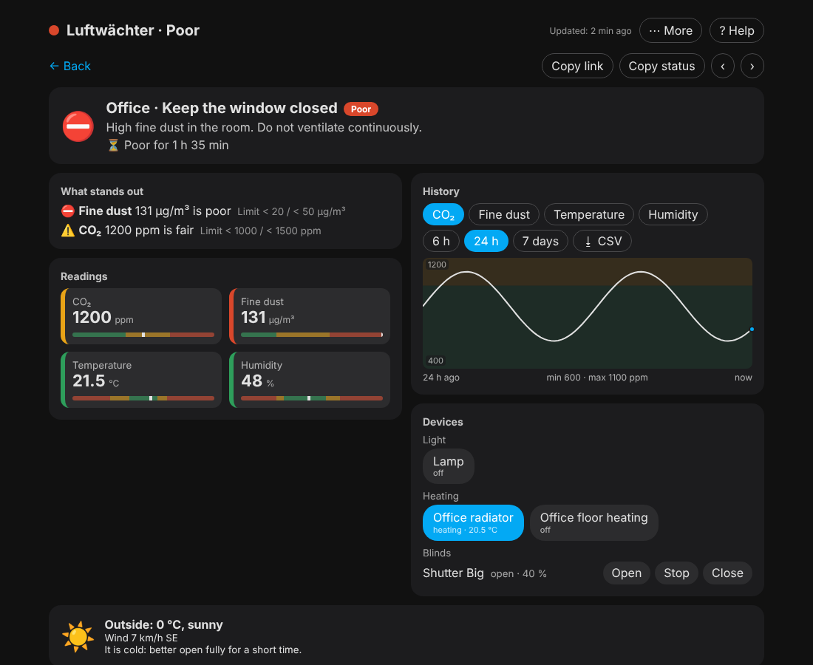
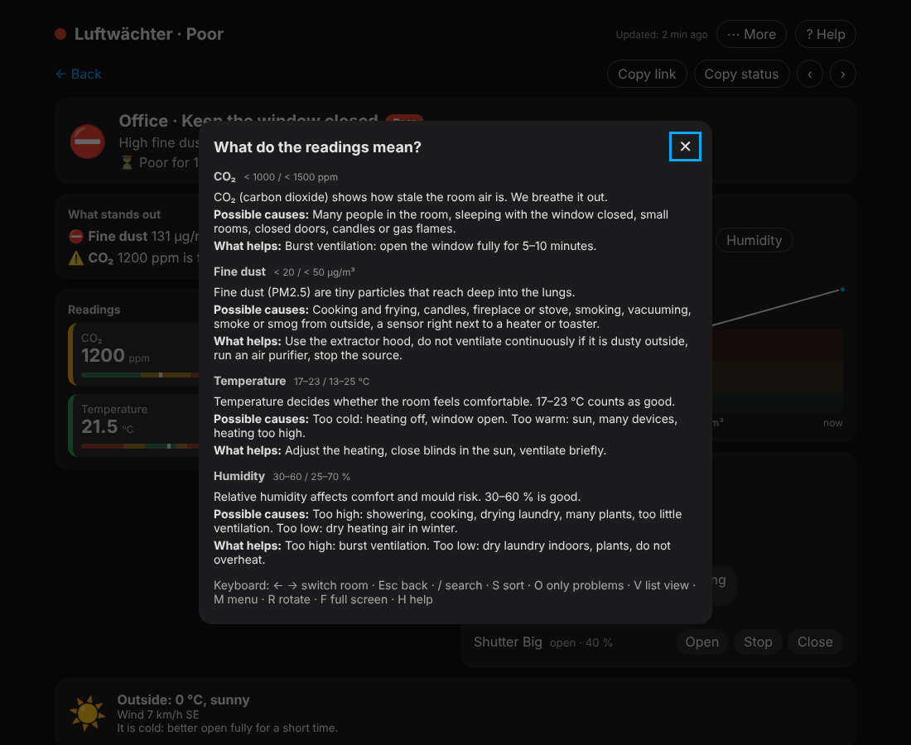
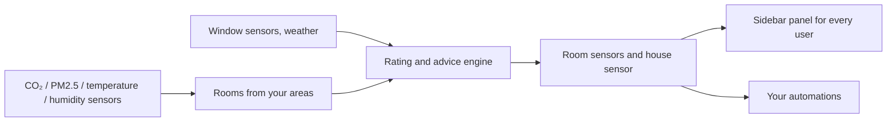

<p align="center"></p>

# Luftwächter for Home Assistant

[](https://github.com/DanStasiak/luftwaechter-ha/actions/workflows/validate.yml)
[](https://github.com/DanStasiak/luftwaechter-ha/releases)

[](LICENSE)
[](https://github.com/DanStasiak/luftwaechter-ha/releases)
[](https://github.com/DanStasiak/luftwaechter-ha/commits/main)
[](https://github.com/DanStasiak/luftwaechter-ha/stargazers)
[](https://github.com/DanStasiak/luftwaechter-ha/issues)

Room air quality, ventilation advice and window hints for Home Assistant, with a sidebar panel for the whole household.
Companion to the [Luftwächter Windows widget](https://github.com/DanStasiak/airguard-widget). German and English, no cloud, no extra requests.

[](https://my.home-assistant.io/redirect/hacs_repository/?owner=DanStasiak&repository=luftwaechter-ha&category=integration)

<p align="center"></p>

**Contents:** [Features](#features) · [Install](#install-marketplace) · [Update](#update) · [How it works](#how-it-works) · [Limits](#limits) · [Entities](#entities) · [Settings](#settings) · [Events](#events-for-automations) · [Blueprint](#blueprint) · [Wall tablet tips](#wall-tablet-tips) · [FAQ](#faq) · [Roadmap](#roadmap) · [Troubleshooting](#troubleshooting) · [Privacy](#privacy)

## Features
- **Do-now overview**: which rooms need attention, worst first, with a coloured dot per reading on every tile.
- **Room view**: status badge, "what stands out" with the limits, gauge bars, 24 h / 6 h / 7 day history charts with hover readout.
- **Advice**: open, close or keep the window; how long to ventilate; wait for storms; rain-soon hint from your weather forecast.
- **Help built in**: what each reading means, typical causes of bad values, what helps.
- **Devices per room**: lights, heating, blinds (open / stop / close) with live state.
- **Made for shared screens**: text size switch for wall tablets, remembers your last room, arrow keys, stale-data warning.
- **Readings at a glance**: every tile lists all four readings, and a CO₂ ranking compares the rooms.
- **Better charts**: axis labels, a marker for the latest value, and a CSV download of the shown history.
- **Light and dark**: follows your Home Assistant theme.
- **Hide areas** you do not want in the panel (garage, cellar).
- **Your limits**: adjust the CO₂ and fine dust limits in the integration options.
- **Trends and events**: rising/falling arrows, and an event whenever a room changes level, for your own automations.
- **Keyboard shortcuts** for wall tablets and desktops.
- **Ventilation timer**: start a countdown for the recommended time and get a clear "close the window now" alert, even after switching rooms.
- **House at a glance**: average CO₂, fine dust, temperature and humidity, a level label on every tile, and "copy house status" to share it.
- **Your language, per person**: each user sees the panel in their own profile language (English or German).
- **Easy to start**: a built-in guide when no rooms are found yet, deep links (`#room=<name>`) and a full-screen button.
- **Mold warning**: at 70 % humidity or more a room gets a tip, and the room view shows the dew point.
- **Search and list view**: find a room by name (press `/`) and switch the overview to a compact list (press `V`).
- **Tidy header, clear menu**: everything secondary sits in a labelled **More** menu (press `M`).
- **Sparklines and time in level**: the last hour on every tile, and "Poor for 1 h 35 min" in the room view.
- **Color-blind mode** with symbols next to the colours, and **Refresh now** from the panel.
- **Automation blueprint**: one click to get a "room became poor" notification, no YAML needed.
- **Timer sound** (optional) and a **copy link** button for the deep link to a room.
- **Entities for automations**: one sensor per room, a house sensor and an "Attention" binary sensor.

| Light theme | Phone |
|---|---|
|  |  |

| List view |
|---|
|  |

| More menu |
|---|
|  |

| German | Ventilation timer |
|---|---|
|  |  |

| Room | Help |
|---|---|
|  |  |

## Install (Marketplace)
Home Assistant 2026.11 and newer have the **Marketplace** built in (Settings → Marketplace). It replaced HACS. On older versions use HACS → ⋮ → **Custom repositories** (type *Integration*) instead of "Add from link".
1. Click the button above, or open **Settings → Marketplace → Add from link** and paste `https://github.com/DanStasiak/luftwaechter-ha`. On the first visit you accept the Marketplace risk notice; custom projects also need a GitHub connection (Home Assistant shows a code to enter on GitHub, no password is shared).
2. Open **Luftwächter** in the Marketplace, click **Download**, then restart Home Assistant.
3. Settings → Devices & services → **Add integration** → *Luftwächter*. Pick a weather entity (optional, used for outside hints).
4. Open **Luftwächter** in the sidebar. It is visible to every household user.

Requires Home Assistant 2025.10 or newer.

**Manual install:** download `luftwaechter.zip` from the [latest release](https://github.com/DanStasiak/luftwaechter-ha/releases/latest), unzip it into `config/custom_components/luftwaechter/` and restart Home Assistant.

## Update
1. **Settings → Marketplace → Installed → Luftwächter → Update** (or the update entity under Settings → Updates).
2. **Restart Home Assistant.** The integration's Python code is only loaded at startup, so a restart is needed for new logic.
3. Hard-refresh the browser (Ctrl+Shift+R) or reopen the app, so the panel loads the new JavaScript.

## Settings
**Settings → Devices & services → Luftwächter → Configure**: choose the weather entity, the areas to hide, the CO₂ and fine dust limits (defaults 1000 / 1500 ppm and 20 / 50 µg/m³) and after how many minutes without data the panel warns (default 10). Temperature and humidity use fixed comfort ranges. The panel, gauges and advice follow your limits.

## How it works

The integration recalculates every minute (or on demand with the `luftwaechter.refresh` action). The engine is plain Python without Home Assistant imports and is covered by tests.

## How rooms are found
Put your CO₂ and/or fine dust (PM2.5) sensors into an **area**. Temperature, humidity and window sensors in the same area are used too.
Optional: give entities the label `airguard` to choose exactly which sensors and devices are used. Without the label the panel shows lights, heating and blinds of the area.

## Limits
| Reading | Good | Fair | Poor |
|---|---|---|---|
| CO₂ | < 1000 ppm | < 1500 ppm | above |
| Fine dust (PM2.5) | < 20 µg/m³ | < 50 µg/m³ | above |
| Temperature | 17–23 °C | 13–25 °C | outside |
| Humidity | 30–60 % | 25–70 % | outside |

The room level is the worst of the four.

## Entities
| Entity | State | Attributes |
|---|---|---|
| `sensor.luftwachter_<room>` | good / fair / poor | action, headline, detail, window, trend, since, mold, dew, values, devices, sources |
| `sensor.luftwachter_house` | worst level | rooms, outside, limits, updated, attention, attention_rooms, worst_room |
| `binary_sensor.luftwachter_attention` | on while a room is poor or advises opening / waiting | count, rooms, worst_room |

Example automation: notify when a room gets poor.
```yaml
triggers:
  - trigger: state
    entity_id: sensor.luftwachter_house
    to: poor
actions:
  - action: notify.notify
    data: { message: "Air quality is poor, open a window." }
```
(Entity IDs depend on your installation; check the entity list.)

### Events for automations
Whenever a room changes level, Luftwächter fires `luftwaechter_level_changed` with `room`, `room_key`, `from`, `to` and `headline`.
```yaml
triggers:
  - trigger: event
    event_type: luftwaechter_level_changed
    event_data: { to: poor }
actions:
  - action: notify.notify
    data: { message: "{{ trigger.event.data.room }}: {{ trigger.event.data.headline }}" }
```
The room attribute `trend` is `up`, `down` or `flat` (CO₂ or fine dust compared with about 15 minutes ago), and `since` is how many minutes the room has been at its current level.

### Blueprint
Prefer clicks to YAML? Import the blueprint and pick the level, an optional room and what should happen (notification, speech, a light, anything). In your actions you can use `{{ room }}`, `{{ headline }}`, `{{ level }}` and `{{ previous }}`.

[](https://my.home-assistant.io/redirect/blueprint_import/?blueprint_url=https%3A%2F%2Fgithub.com%2FDanStasiak%2Fluftwaechter-ha%2Fblob%2Fmain%2Fblueprints%2Fautomation%2Fluftwaechter%2Flevel_changed.yaml)

## Actions and diagnostics
- `luftwaechter.refresh` recalculates all rooms immediately.
- **Download diagnostics** (device page, three dots) gives a compact, anonymous report for bug reports: levels, readings, sources and device ids, no names of people or accounts.

## Wall tablet tips
- Keyboard: ← → switch room, Esc back, **/** search, **S** sort, **O** only problems, **V** list view, **M** menu, **R** rotate rooms, **F** full screen, **H** help.
- **Rotate** (⟳ button or **R**) steps through the rooms every 12 seconds; a tap stops it. In full screen the panel asks the tablet to keep the screen on.
- The header stays visible while you scroll.
- Open the panel once, choose the **Aa** size, press the full-screen button.
- Link straight to a room: `https://<your-ha>/luftwaechter#room=<room-key>` (the key is shown in the sensor attributes).
- The panel warns when its data is older than 10 minutes, so a frozen tablet is visible.

## FAQ
**Why is a room red when CO₂ is fine?** The room level is the worst of its readings. The tile names the reading that caused it.

**Can I change the limits?** Yes, CO₂ and fine dust, under Configure (see Settings). Temperature and humidity use fixed comfort ranges.

**What does the mold warning mean?** From 70 % relative humidity, mold can grow on cold surfaces such as outer walls. The tip is a guideline, not a measurement of mold; ventilate briefly and keep furniture off cold walls.

**Can I use the panel if I cannot tell red from green?** Yes: turn on **Color-blind mode** in the **More** menu. Every reading then also shows a symbol (✓ fine, ! fair, ✕ poor).

**Do I need a window sensor?** No. With one (device class "window") you get "open / close the window" advice; without it you get ventilation advice only.

**Does it send data anywhere?** No, see Privacy.

**Which languages?** English and German, chosen per user from the profile language.

## Troubleshooting
- **No rooms in the panel**: the sensors must belong to an area (directly or through their device) and be CO₂ or PM2.5 sensors.
- **A room is red but CO₂ is fine**: another reading is poor, usually fine dust. The tile names it.
- **Panel text in the wrong language**: the panel uses your *profile* language (Profile → Language), not the system language. Update to 0.3.1 or later.
- **Panel looks old after an update**: restart Home Assistant, then hard-refresh the browser (Ctrl+Shift+R) or reopen the app (see Update).
- **Can't find HACS**: in Home Assistant 2026.11 and newer it is the Marketplace under Settings.
- **Too many devices listed**: give only the wanted ones the label `airguard`.
- **History chart is empty**: the sensors need recorder history; recorder-excluded sensors have none.

## Roadmap
Ideas, not promises: more languages (translations welcome), more sensor types, limits per room, a Lovelace card. Tell me what you need in an [issue](https://github.com/DanStasiak/luftwaechter-ha/issues).

## Privacy
Everything runs inside your Home Assistant. No accounts, no cloud services, no telemetry.

## Contributing
Issues and pull requests are welcome, see [CONTRIBUTING.md](CONTRIBUTING.md). Changes are listed in the [changelog](CHANGELOG.md).

MIT © 2026 Dan Stasiak
