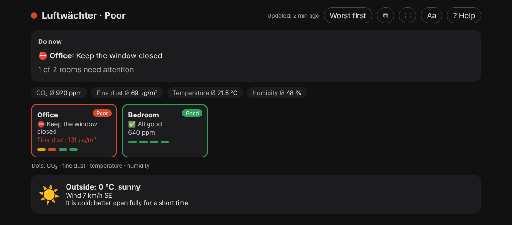
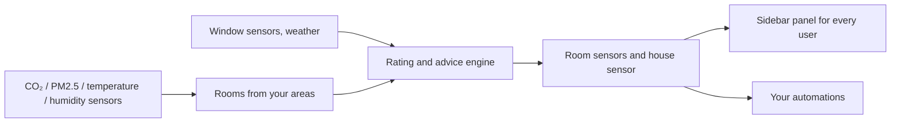

<p align="center"></p>

# Luftwächter for Home Assistant

[](https://github.com/DanStasiak/luftwaechter-ha/actions/workflows/validate.yml)
[](https://github.com/DanStasiak/luftwaechter-ha/releases)
[](https://hacs.xyz)
[](LICENSE)

Room air quality, ventilation advice and window hints for Home Assistant, with a sidebar panel for the whole household.
Companion to the [Luftwächter Windows widget](https://github.com/DanStasiak/airguard-widget). German and English, no cloud, no extra requests.

[](https://my.home-assistant.io/redirect/hacs_repository/?owner=DanStasiak&repository=luftwaechter-ha&category=integration)

<p align="center"></p>

**Contents:** [Features](#features) · [Install](#install-hacs) · [How it works](#how-it-works) · [Limits](#limits) · [Entities](#entities) · [Wall tablet tips](#wall-tablet-tips) · [FAQ](#faq) · [Troubleshooting](#troubleshooting) · [Privacy](#privacy)

## Features
- **Do-now overview**: which rooms need attention, worst first, with a coloured dot per reading on every tile.
- **Room view**: status badge, "what stands out" with the limits, gauge bars, 24 h / 6 h / 7 day history charts with hover readout.
- **Advice**: open, close or keep the window; how long to ventilate; wait for storms; rain-soon hint from your weather forecast.
- **Help built in**: what each reading means, typical causes of bad values, what helps.
- **Devices per room**: lights, heating, blinds (open / stop / close) with live state.
- **Made for shared screens**: text size switch for wall tablets, remembers your last room, arrow keys, stale-data warning.
- **Ventilation timer**: start a countdown for the recommended time and get a clear "close the window now" alert, even after switching rooms.
- **House at a glance**: average CO₂, fine dust, temperature and humidity, a level label on every tile, and "copy house status" to share it.
- **Your language, per person**: each user sees the panel in their own profile language (English or German).
- **Easy to start**: a built-in guide when no rooms are found yet, deep links (`#room=<name>`) and a full-screen button.
- **Entities for automations**: one sensor per room and a house sensor.

| Room | Help |
|---|---|
|  |  |

## Install (HACS)
1. Click the button above, or HACS → ⋮ → **Custom repositories** → add `https://github.com/DanStasiak/luftwaechter-ha` as type *Integration*.
2. Download **Luftwächter**, then restart Home Assistant.
3. Settings → Devices & services → **Add integration** → *Luftwächter*. Pick a weather entity (optional, used for outside hints).
4. Open **Luftwächter** in the sidebar. It is visible to every household user.

Requires Home Assistant 2025.10 or newer.

## How it works

The integration recalculates every minute (or on demand with the `luftwaechter.refresh` action). The engine is plain Python without Home Assistant imports and is covered by tests.

## How rooms are found
Put your CO₂ and/or fine dust (PM2.5) sensors into an **area**. Temperature, humidity and window sensors in the same area are used too.
Optional: give entities the label `airguard` to choose exactly which sensors and devices are used. Without the label the panel shows lights, heating and blinds of the area.

## Limits
| Reading | Good | Fair | Poor |
|---|---|---|---|
| CO₂ | < 1000 ppm | < 1500 ppm | above |
| Fine dust (PM2.5) | < 20 µg/m³ | < 50 µg/m³ | above |
| Temperature | 17–23 °C | 13–25 °C | outside |
| Humidity | 30–60 % | 25–70 % | outside |

The room level is the worst of the four.

## Entities
| Entity | State | Attributes |
|---|---|---|
| `sensor.luftwaechter_<room>` | good / fair / poor | action, headline, detail, window, values, devices, sources |
| `sensor.luftwaechter_house` | worst level | rooms, outside, updated |

Example automation: notify when a room gets poor.
```yaml
triggers:
  - trigger: state
    entity_id: sensor.luftwaechter_house
    to: poor
actions:
  - action: notify.notify
    data: { message: "Air quality is poor, open a window." }
```
(Entity IDs depend on your installation; check the entity list.)

## Actions and diagnostics
- `luftwaechter.refresh` recalculates all rooms immediately.
- **Download diagnostics** (device page, three dots) gives a compact, anonymous report for bug reports: levels, readings, sources and device ids, no names of people or accounts.

## Wall tablet tips
- Open the panel once, choose the **Aa** size, press the full-screen button.
- Link straight to a room: `https://<your-ha>/luftwaechter#room=<room-key>` (the key is shown in the sensor attributes).
- The panel warns when its data is older than 10 minutes, so a frozen tablet is visible.

## FAQ
**Why is a room red when CO₂ is fine?** The room level is the worst of its readings. The tile names the reading that caused it.

**Can I change the limits?** Not yet; they follow common indoor-air guidance (see Limits). Open a feature request if you need other values.

**Do I need a window sensor?** No. With one (device class "window") you get "open / close the window" advice; without it you get ventilation advice only.

**Does it send data anywhere?** No, see Privacy.

**Which languages?** English and German, chosen per user from the profile language.

## Troubleshooting
- **No rooms in the panel**: the sensors must belong to an area (directly or through their device) and be CO₂ or PM2.5 sensors.
- **A room is red but CO₂ is fine**: another reading is poor, usually fine dust. The tile names it.
- **Panel text in the wrong language**: the panel uses your *profile* language (Profile → Language), not the system language. Update to 0.3.1 or later.
- **Panel looks old after an update**: restart Home Assistant, then hard-refresh the browser (Ctrl+Shift+R) or reopen the app.
- **Too many devices listed**: give only the wanted ones the label `airguard`.
- **History chart is empty**: the sensors need recorder history; recorder-excluded sensors have none.

## Privacy
Everything runs inside your Home Assistant. No accounts, no cloud services, no telemetry.

## Contributing
Issues and pull requests are welcome, see [CONTRIBUTING.md](CONTRIBUTING.md). Changes are listed in the [changelog](CHANGELOG.md).

MIT © 2026 Dan Stasiak
