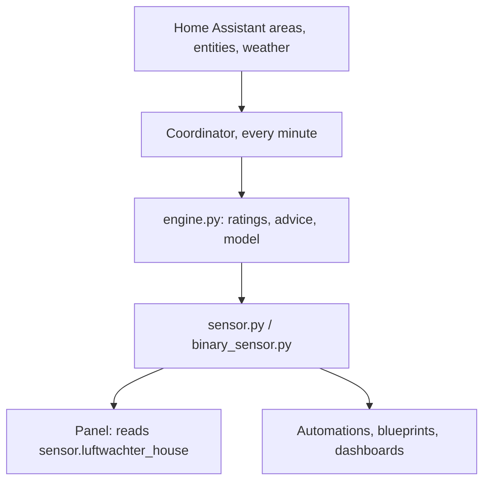

# How it is built

- **engine.py** has no Home Assistant imports. It takes plain dictionaries and returns the model, so it is tested without a running Home Assistant.
- **coordinator.py** collects rooms from areas (a room needs a CO₂ or fine-dust sensor) and calls the engine.
- **sensor.py / binary_sensor.py** publish the model. The house sensor carries the whole model as attributes; the panel needs nothing else.
- **frontend/luftwaechter-panel.js** is one web component without a build step. Settings live in the browser (`localStorage`, with an in-memory fallback).
- **blueprints/** are plain YAML and are checked by the tests.
